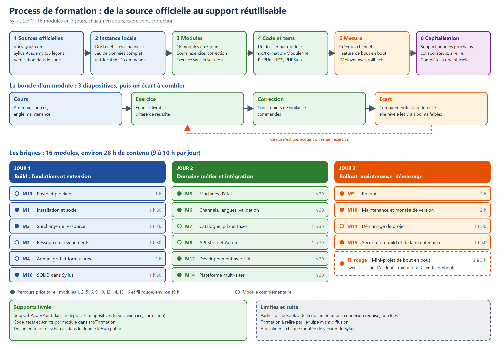
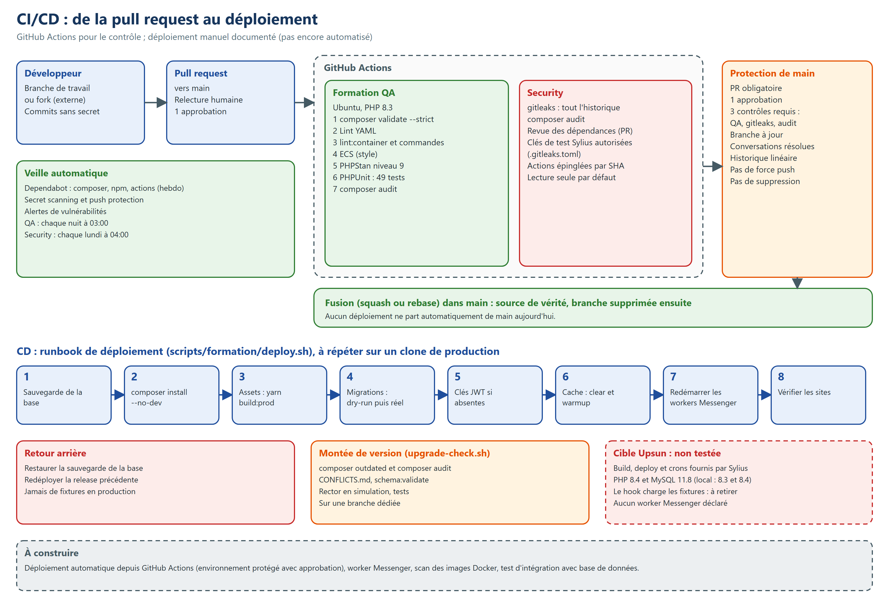
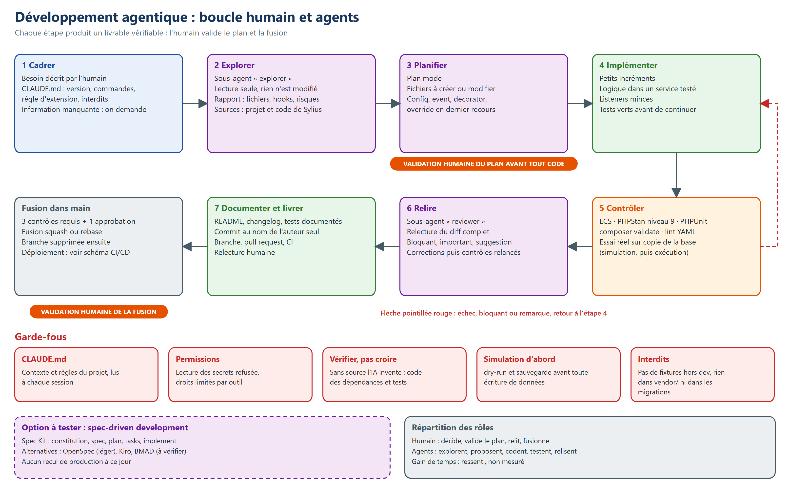
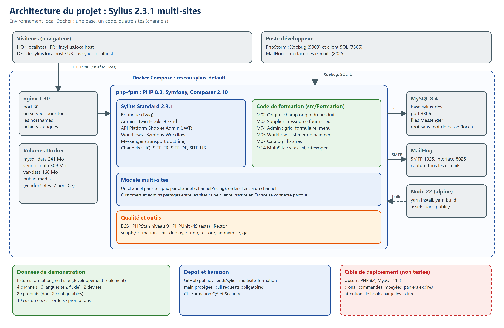

# Sylius multi-sites : formation pratique

Formation **Sylius 2.3.1** pour monter en compétence sur un projet e-commerce multi-sites : **16 modules en 3 jours** (cours, exercice, correction), appuyés sur une instance locale à quatre sites (un *channel* par site : HQ, France, Allemagne, États-Unis), du code par module, un jeu de données complet, des outils d'exploitation et une chaîne de qualité.

La formation **intègre la CI/CD** (pipeline de qualité et de sécurité, déploiement et retour arrière) et **le développement avec l'IA en mode agentique** (méthode, garde-fous, boucle avec validation humaine).

> Projet pédagogique, **non officiel** : il n'est ni affilié ni approuvé par Sylius. Il est construit sur [Sylius-Standard](https://github.com/Sylius/Sylius-Standard) (licence MIT, voir `LICENSE`). Le nom et le logo Sylius restent la propriété de leurs titulaires (voir `LICENSE_OF_TRADEMARK_AND_LOGO`).

## La formation en un coup d'œil



### Les étapes à suivre

1. **Partir des sources officielles** : la documentation ([docs.sylius.com](https://docs.sylius.com)) et le cours de la Sylius Academy ; vérifier dans le code de Sylius en cas de doute.
2. **Monter l'instance locale** : `scripts/formation/init-local.sh` démarre Docker, installe ce qui manque et charge le jeu de données (voir le démarrage rapide plus bas).
3. **Suivre les modules** : lire le cours, faire l'exercice **sans regarder la correction**, puis comparer et noter l'écart. Ce qui n'est pas acquis, on le refait.
4. **Lire et exécuter le code** : un dossier par module dans `src/Formation/ModuleNN`, vérifié par `vendor/bin/phpunit tests/Formation`.
5. **Mesurer l'avancement** avec des capacités concrètes : créer un channel, ajouter une feature de bout en bout avec ses tests, déployer avec retour arrière, faire un upgrade de patch, anonymiser une base.
6. **Capitaliser** : consigner ce qui est appris avec ses sources, puis faire relire la formation avant de la transmettre aux prochains collaborateurs.

### Planning des 3 jours

| Jour | Thème | Modules |
|---|---|---|
| 1 | Build : fondations et extension | M13 Poste et pipeline · M1 Installation et socle · M2 Surcharge de ressource · M3 Ressource et événements · M4 Admin, grid et formulaires · M16 SOLID dans Sylius |
| 2 | Domaine métier et intégration | M5 Machines d'état · M6 Channels, langues, validation · M7 Catalogue, prix et taxes · M8 API Shop et Admin · M12 Développement avec l'IA · M14 Plateforme multi-sites |
| 3 | Rollout, maintenance, démarrage | M9 Rollout · M10 Maintenance et montée de version · M11 Démarrage de projet · M15 Sécurité du build et de la maintenance · fil rouge de 2 à 3 h (mini-projet de bout en bout) |

Contenu complet : environ 28 h, soit 9 à 10 h par jour. **Parcours prioritaire** (environ 19 h) : modules 1, 2, 5, 6, 9, 10, 12, 14, 15, 16 et fil rouge. Le détail module par module (code, tests, scripts) est dans la [carte des modules](docs/formation/README.md). Le **support PowerPoint** de la formation (71 diapositives : cours, exercice et correction par module) est dans le dépôt : [`docs/formation/Formation_Sylius_3_jours.pptx`](docs/formation/Formation_Sylius_3_jours.pptx).

## CI/CD et développement agentique intégrés

### CI/CD



Modules concernés : **M9** Rollout (préparer, déployer, vérifier, revenir en arrière) · **M10** Maintenance et montée de version · **M11** Démarrage de projet (conventions, qualité, CI) · **M13** Poste de développement et pipeline · **M15** Sécurité du build, des secrets et du pipeline.

Dans ce dépôt : les workflows `Formation QA` (composer, YAML, ECS, PHPStan niveau 9, PHPUnit) et `Security` (gitleaks, audit des dépendances), la protection de `main` par ruleset, et le runbook `scripts/formation/deploy.sh`. Le déploiement automatique depuis GitHub Actions n'est pas encore en place.

### Développement agentique



Module concerné : **M12** Développer avec l'IA (méthode et garde-fous), avec ses compléments : modèles de prompts pour Sylius, garde-fous techniques (permissions et hooks) et gouvernance de l'IA dans l'équipe. Le **fil rouge** du jour 3 se réalise avec l'assistant IA.

La boucle enseignée : cadrer, explorer en lecture seule, planifier (plan validé par un humain), implémenter par petits incréments, contrôler (tests, qualité), faire relire, puis livrer par pull request. Les règles données à l'assistant sont dans [`CLAUDE.md`](CLAUDE.md). Les gains de temps ne sont pas mesurés.

## Architecture du projet



## Ce que contient le dépôt

| Élément | Où |
|---|---|
| Support PowerPoint de la formation (71 diapositives) | [`docs/formation/Formation_Sylius_3_jours.pptx`](docs/formation/Formation_Sylius_3_jours.pptx) |
| Documentation de formation, modules, comptes locaux | [`docs/formation/README.md`](docs/formation/README.md) |
| Code de formation par module (`ModuleNN<Nom>`) | `src/Formation/` |
| Commande d'ouverture d'un site depuis un fichier YAML (`formation:sites:open`, avec `--dry-run`) | [`docs/formation/ouverture-site.md`](docs/formation/ouverture-site.md) |
| Jeu de données multi-sites (fixtures `formation_multisite`) | `config/packages/formation_m14_multisite_fixtures.yaml` |
| Données et correctifs de données, anonymisation, dump/restauration | [`docs/formation/donnees-et-hotfix.md`](docs/formation/donnees-et-hotfix.md), `scripts/formation/` |
| Principes SOLID appliqués à Sylius | [`docs/formation/solid.md`](docs/formation/solid.md) |
| Consignes pour l'assistant IA du projet | [`CLAUDE.md`](CLAUDE.md) |
| Schémas : process de formation, architecture, développement agentique, CI/CD (PNG et SVG) | [`docs/formation/diagrams/`](docs/formation/diagrams/) |

## Démarrage rapide (développement local, Docker)

```bash
make up                                                          # démarre PHP, Nginx, MySQL, Node
make php-shell                                                   # shell dans le conteneur PHP
php bin/console sylius:fixtures:load formation_multisite         # développement uniquement : vide la base
php bin/console formation:sites:list
```

## Qualité et sécurité

| Contrôle | Outil | Quand |
|---|---|---|
| Style, analyse statique (niveau 9), tests | ECS, PHPStan, PHPUnit | chaque pull request et chaque nuit (`Formation QA`) |
| `composer.json`, YAML, conteneur Symfony | `composer validate --strict`, lint YAML, `lint:container` | idem |
| Dépendances vulnérables | `composer audit`, revue des dépendances | chaque pull request, chaque semaine (`Security`) |
| Secrets (clés, tokens, mots de passe) dans le code **et l'historique** | gitleaks, GitHub secret scanning avec push protection | chaque push, chaque pull request, chaque semaine |
| Mises à jour | Dependabot (composer, npm, GitHub Actions) | chaque semaine |

Les clés `config/jwt/*-test.pem`, `config/encryption/test.key` et la phrase de passe de test du fichier `.env` viennent de Sylius-Standard : ce sont des **valeurs de test publiques**, jamais utilisées en production. Elles sont explicitement autorisées dans [`.gitleaks.toml`](.gitleaks.toml). Les comptes de la documentation sont ceux des fixtures locales. Voir [`SECURITY.md`](SECURITY.md) pour signaler une vulnérabilité.

---

<p align="center">
    <a href="https://sylius.com" target="_blank">
        <picture>
          <source media="(prefers-color-scheme: dark)" srcset="https://media.sylius.com/sylius-logo-800-dark.png">
          <source media="(prefers-color-scheme: light)" srcset="https://media.sylius.com/sylius-logo-800.png">
          
        </picture>
    </a>
</p>

<h1 align="center">Sylius Standard Edition</h1>

<p align="center">This is Sylius Standard Edition repository for starting new projects.</p>

## About

Sylius is the first decoupled eCommerce framework based on [**Symfony**](http://symfony.com) and [**Doctrine**](http://doctrine-project.org). 
The highest quality of code, strong testing culture, built-in Agile (BDD) workflow and exceptional flexibility make it the best solution for application tailored to your business requirements. 
Enjoy being an eCommerce Developer again!

Powerful REST API allows for easy integrations and creating unique customer experience on any device.

We're using full-stack Behavior-Driven-Development, with [Behat](http://behat.org)

## Documentation

Documentation is available at [docs.sylius.com](http://docs.sylius.com).

## Installation

### Traditional
```bash
$ wget http://getcomposer.org/composer.phar
$ php composer.phar create-project sylius/sylius-standard project
$ cd project
$ yarn install
$ yarn build
$ php bin/console sylius:install
$ symfony serve
$ open http://localhost:8000/
```

For more detailed instruction about traditional way of running Sylius please visit [installation chapter in our docs](https://docs.sylius.com/the-book/sylius-ce-installation).

### Docker

You can run Sylius and all associated infrastructure dependencies (PHP, Nginx, MySQL, Node) on your machine using only Docker containers. Make sure you have installed [Docker](https://docs.docker.com/get-docker/) on your local machine.

**Option 1: Get the latest release**
```bash
LATEST=$(curl -s https://api.github.com/repos/Sylius/Sylius-Standard/releases/latest | grep '"tag_name"' | cut -d'"' -f4)
curl -L -o sylius-latest.zip https://github.com/Sylius/Sylius-Standard/archive/refs/tags/$LATEST.zip
unzip sylius-latest.zip
cd Sylius-Standard-*
```

**Option 2: List available versions**
```bash
curl -s https://api.github.com/repos/Sylius/Sylius-Standard/releases | grep '"tag_name"' | cut -d'"' -f4 | head -10
```

**Option 3: Get a specific version**
```bash
VERSION="v2.x.x"  # Replace with desired version
curl -L -o sylius-$VERSION.zip https://github.com/Sylius/Sylius-Standard/archive/refs/tags/$VERSION.zip
unzip sylius-$VERSION.zip
cd Sylius-Standard-*
```

**Initialize the project (required for all options):**
```bash
make init
```

For more detailed instruction about Docker way of running Sylius please visit [Docker installation chapter in our docs](https://docs.sylius.com/getting-started-with-sylius/sylius-ce-installation-with-docker).

## Troubleshooting

If something goes wrong, errors & exceptions are logged at the application level:

```bash
$ tail -f var/log/prod.log
$ tail -f var/log/dev.log
```

## Contributing

Would like to help us and build the most developer-friendly eCommerce framework? Start from reading our [Contribution Guide](https://docs.sylius.com/en/latest/contributing/)!

## Stay Updated

If you want to keep up with the updates, [follow the official Sylius account on Twitter](http://twitter.com/Sylius) and [like us on Facebook](https://www.facebook.com/SyliusEcommerce/).

## Bug Tracking

If you want to report a bug or suggest an idea, please use [GitHub issues](https://github.com/Sylius/Sylius/issues).

## Community Support

Get Sylius support on [Slack](https://sylius.com/slack), [Forum](https://forum.sylius.com/) or [Stack Overflow](https://stackoverflow.com/questions/tagged/sylius).

## MIT License

Sylius is completely free and released under the [MIT License](https://github.com/Sylius/Sylius/blob/master/LICENSE).

## Authors

Sylius was originally created by [Paweł Jędrzejewski](http://pjedrzejewski.com).
See the list of [contributors from our awesome community](https://github.com/Sylius/Sylius/contributors).
