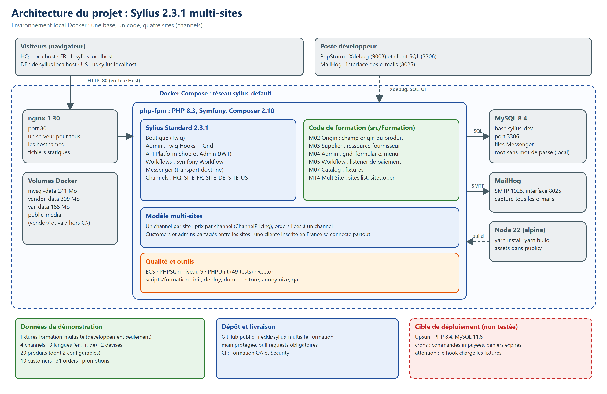
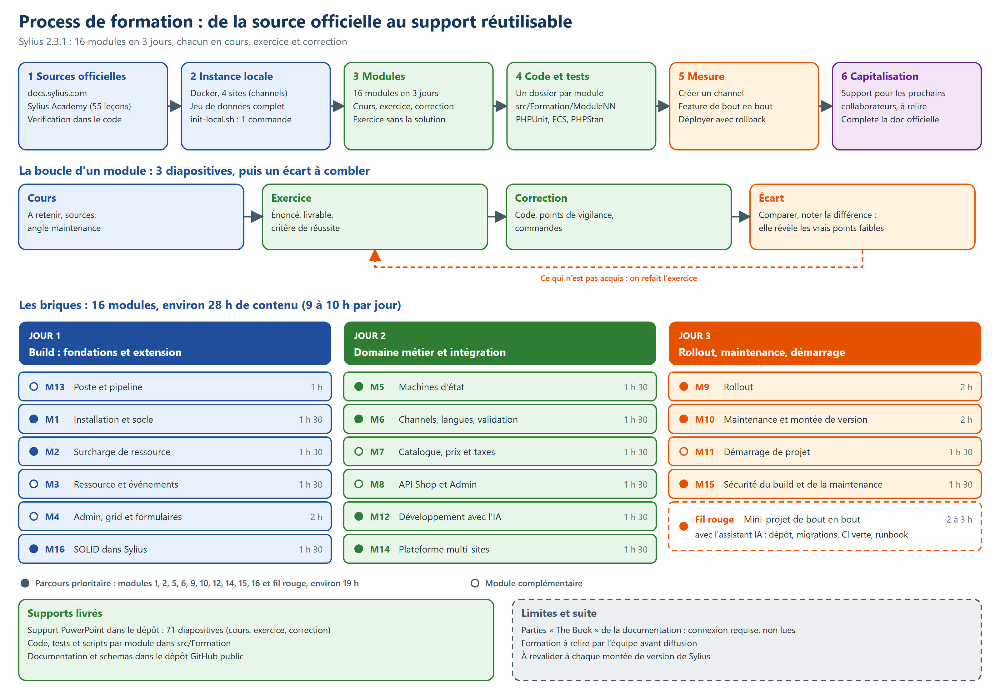
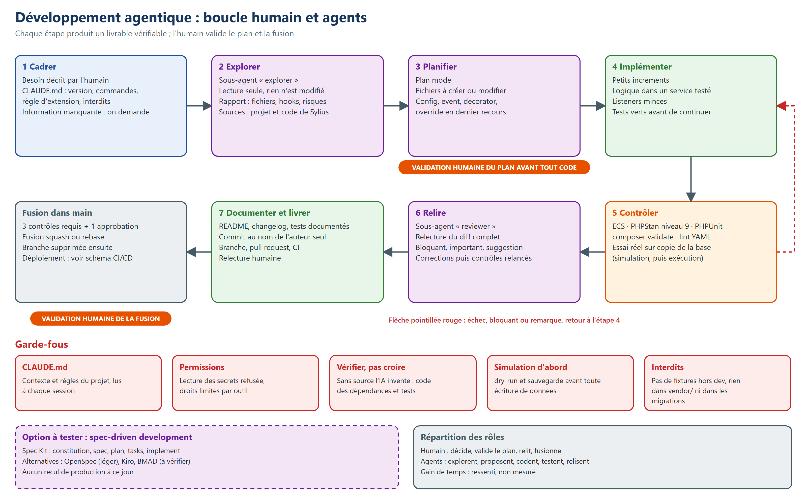
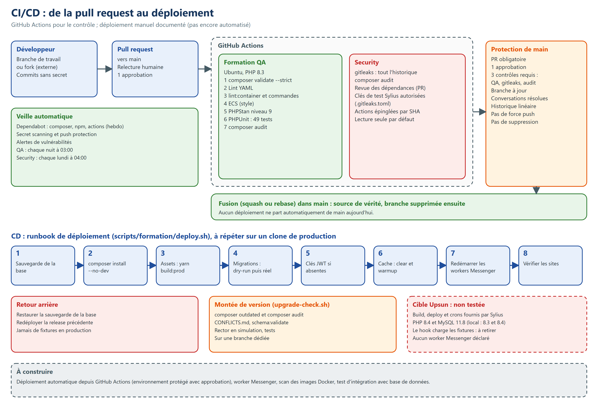

# Formation Sylius : instance locale multi-sites et modules de code

Projet `sylius-standard` 2.3.1 avec une instance **multi-sites / multi-marchés** (un channel par site)
et un module de code par cours de la formation (cours, exercice et correction du [support PowerPoint](Formation_Sylius_3_jours.pptx)).

Autres documents : [données et hotfix](donnees-et-hotfix.md) · [principes SOLID](solid.md) · [ouverture d'un site](ouverture-site.md) · [architecture Docker (DAT)](architecture-docker.md) · [process agentique](process-agentique.md) · [roadmap](roadmap.md) · [simuler un ticket](simuler-un-ticket.md).



*Architecture du projet (source modifiable : [`diagrams/architecture-projet.svg`](diagrams/architecture-projet.svg)). Détail des images et des conteneurs : [architecture Docker](architecture-docker.md).*

## Démarrage

### Initialisation complète en une commande (recommandé)

```bash
scripts/formation/init-local.sh                # démarre, installe ce qui manque, charge le jeu de données
scripts/formation/init-local.sh --reset        # supprime la base, la recrée, recharge le jeu de données
scripts/formation/init-local.sh --no-fixtures  # base migrée mais vide
```

> **`make init` n'installe pas ce jeu de données** : il charge la suite de démonstration par défaut de Sylius.
> Après `make clean` (qui supprime aussi les volumes `vendor` et base), relancer `init-local.sh`.
> Données partagées, instantanés, anonymisation et correctifs de données : [donnees-et-hotfix.md](donnees-et-hotfix.md).

### Étape par étape

```bash
make up                       # conteneurs : php, nginx, mysql, mailhog
make php-shell                # shell dans le conteneur PHP : les commandes ci-dessous s'y lancent
                              # (depuis le terminal de l'hôte : make console ARGS="<commande>")

php bin/console doctrine:migrations:migrate -n
php bin/console lexik:jwt:generate-keypair --skip-if-exists   # clés JWT de l'API (ignorées par Git)
php bin/console sylius:fixtures:load formation_multisite -n   # jeu de données complet (environ 3 à 4 minutes)
php bin/console messenger:consume main catalog_promotion_removal --time-limit=40   # applique la promotion de catalogue
php bin/console formation:sites:list
```

Recharger les fixtures **efface et recrée** toutes les données (produits, clients, commandes, promotions, fournisseurs).

> Les commandes `php bin/console ...` se lancent **dans le conteneur** (PHP 8.3) : dans `make php-shell`, ou depuis l'hôte avec `make console ARGS='formation:sites:list'` (équivalent : `scripts/formation/console.sh formation:sites:list`). Lancé directement dans un terminal Windows, `php` est celui du poste, souvent trop ancien (voir le Dépannage).
> Sous Git Bash, le script n'ouvre pas de terminal interactif : ajouter `--no-interaction` (`-n`) aux commandes qui posent des questions, ou `CONSOLE_FORCE_TTY=1` (avec winpty). Avec `make`, mettre `ARGS` entre guillemets simples pour passer plusieurs arguments.
> Sous Windows, `bin/console` n'est pas exécutable : toujours l'appeler par `php bin/console ...`.

### Sites locaux

| Site | URL | Channel | Devise | Langue |
|---|---|---|---|---|
| Portail global | http://localhost | `HQ` | EUR / USD | en_US, fr_FR, de_DE |
| France | http://fr.sylius.localhost | `SITE_FR` | EUR | fr_FR |
| Allemagne | http://de.sylius.localhost | `SITE_DE` | EUR | de_DE |
| États-Unis | http://us.sylius.localhost | `SITE_US` | USD | en_US |

Les domaines `*.localhost` pointent vers la machine locale dans les navigateurs modernes ; sinon, ajouter
les hostnames au fichier `hosts`.

### Jeu de données

Défini dans `config/packages/formation_m14_multisite_fixtures.yaml` (suite `formation_multisite`).

| Donnée | Contenu |
|---|---|
| Catalogue | 20 produits alimentaires (boissons : café, thé, eau ; épicerie : huiles, épices, produits sucrés), 10 catégories en arbre, images, 3 attributs (marque, bio, durée de conservation) |
| Variantes | 2 produits configurables (café en grains, café moulu) avec l'option « conditionnement » 250 g / 500 g / 1 kg : 24 variantes au total |
| Langues | noms, slugs et descriptions traduits en fr / de / en (fixture `product_enrichment`) ; catégories traduites |
| Visibilité par site | HQ : 20 produits · France : 17 · Allemagne : 17 · États-Unis : 16 (sirop d'érable, beurre de cacahuète et sauce piquante vendus aux États-Unis seulement ; infusion verveine, huile d'olive, huile de colza et pâte à tartiner absents des États-Unis) |
| Prix | un prix par variante et par site (valeurs aléatoires de Sylius, différentes d'un site à l'autre) ; TVA 20 % en Europe, taxe de vente 7 % aux États-Unis |
| Origine et fournisseurs | champ `origin` renseigné sur chaque produit ; 6 fournisseurs (dont 1 désactivé) visibles dans `/admin/suppliers/` |
| Clients | 10 clients : 7 particuliers (groupe `retail`) et 3 acheteurs professionnels (groupe `wholesale`) |
| Commandes | 31 commandes réparties sur les 4 sites, terminées (`fulfilled`) et en cours (`new`) |
| Promotions | code `WELCOME10` (-10 %, tous sites) · France : -10 % dès 50 EUR · États-Unis : livraison offerte dès 75 USD · groupe B2B : -15 % · promotion de catalogue « Journées du café » : -15 % sur le café |
| Paiement et livraison | virement et paiement à la livraison sur tous les sites ; livraison forfaitaire Europe (590 à 790) et États-Unis (999), en centimes |

Les images sont des visuels de démonstration générés (`data/formation/images/`).

### Liens d'administration et outils

L'administration est commune aux 4 sites (un seul back-office pour tous les channels) : le même compte
fonctionne sur n'importe quel hostname.

| Accès | Lien |
|---|---|
| Administration (connexion) | http://localhost/admin/login |
| Administration via le site France | http://fr.sylius.localhost/admin |
| Administration via le site Allemagne | http://de.sylius.localhost/admin |
| Administration via le site États-Unis | http://us.sylius.localhost/admin |
| Channels (sites) | http://localhost/admin/channels/ |
| Produits | http://localhost/admin/products/ |
| Commandes | http://localhost/admin/orders/ |
| Clients et groupes de clients | http://localhost/admin/customers/ · http://localhost/admin/customer-groups/ |
| Fournisseurs (module 3 et 4) | http://localhost/admin/suppliers/ |
| Connexion client (boutique) | http://localhost/en_US/login · http://fr.sylius.localhost/fr_FR/login |
| Documentation de l'API (Swagger) | http://localhost/api/v2/docs |
| API Shop (exemple) | http://fr.sylius.localhost/api/v2/shop/products |
| Courrier de test (Mailhog) | http://localhost:8025 |

### Comptes d'accès (développement local uniquement)

Ces comptes sont créés par la suite de fixtures `formation_multisite`
(`config/packages/formation_m14_multisite_fixtures.yaml`, source de vérité). **Ne jamais les utiliser
en staging ou en production.** Recharger les fixtures remet ces comptes à l'état d'origine.

| Rôle | Identifiant | Mot de passe | Où se connecter |
|---|---|---|---|
| Administrateur | `sylius@example.com` (utilisateur `sylius`) | `sylius` | `/admin/login` |
| Administrateur API | `api@example.com` (utilisateur `api`) | `sylius-api` | jeton API Admin : `POST /api/v2/admin/administrators/token` |
| Client retail (test général) | `shop@example.com` | `sylius` | boutique, `/<locale>/login` |
| Client retail France | `marie.dupont@example.com`, `lucas.martin@example.com` | `sylius` | boutique France |
| Client retail Allemagne | `hans.mueller@example.com`, `anna.schmidt@example.com` | `sylius` | boutique Allemagne |
| Client retail États-Unis | `john.smith@example.com`, `emily.johnson@example.com` | `sylius` | boutique États-Unis |
| Acheteurs B2B (groupe `wholesale`) | `buyer@wholesale.example.com`, `bistro.gourmet@wholesale.example.com`, `hotel.alpes@wholesale.example.com` | `sylius` | boutique, `/<locale>/login` |

Les commandes de démonstration sont rattachées à ces clients : Marie Dupont et Lucas Martin (France), Hans
Müller et Anna Schmidt (Allemagne), John Smith et Emily Johnson (États-Unis), les trois acheteurs B2B
(portail global). Jeton API Admin, exemple :

```bash
curl -s -X POST http://localhost/api/v2/admin/administrators/token \
  -H 'Content-Type: application/json' \
  -d '{"email":"api@example.com","password":"sylius-api"}'
```

Le parcours complet de l'API Shop est dans `scripts/formation/api-parcours.sh` (variables `SITE`, `LOCALE`,
`ADMIN_EMAIL`, `ADMIN_PASSWORD`).

### Performance sous Windows

Le dossier du projet est monté dans Docker par un système de fichiers lent (9p). Dans `compose.override.yml`
(fichier local, non versionné), `vendor/` et `var/` sont des **volumes Docker** (ext4) : les dépendances
vivent donc dans le volume `vendor-data` (installées par `composer install` dans le conteneur) et non dans
le dossier `vendor/` de Windows. Pour utiliser un IDE, configurer l'interpréteur PHP distant Docker (service
`php`). Un `composer install` côté Windows exige PHP 8.3 sur le poste. Avec ce `compose.override.yml`, un `vendor/`
laissé sur Windows par un ancien `make init` est masqué dans le conteneur : seul le PHP du poste le lit.

### Dépannage

Les commandes `php bin/console` de ce tableau se lancent dans le conteneur (voir plus haut).

| Symptôme | Cause et solution |
|---|---|
| `502 Bad Gateway` après `docker compose up -d php` | nginx garde l'ancienne adresse du conteneur PHP : `docker compose restart nginx` |
| `Composer detected issues in your platform: Your Composer dependencies require a PHP version ">= 8.3.0". You are running 8.2.x` | la commande a été lancée avec le PHP du poste (XAMPP 8.2 par exemple) au lieu du conteneur : utiliser `make console ARGS='formation:sites:list'`, `scripts/formation/console.sh formation:sites:list` ou `make php-shell` |
| Commandes console lentes | Xdebug est actif : utiliser `make console ARGS='...'` (Xdebug coupé) ou `docker compose exec -e XDEBUG_MODE=off php php bin/console ...` |
| `Unable to create the "cache" directory` | droits sur `var/` : le volume `var-data` doit appartenir à l'utilisateur 1000 (`docker compose exec -u root php chown -R 1000:1000 var vendor`) |
| `make clean` vide `vendor/` | les volumes sont supprimés : relancer `docker compose exec php composer install` |
| `An error occurred while trying to encode the JWT token` (jeton API) | clés JWT absentes : `php bin/console lexik:jwt:generate-keypair --skip-if-exists` (les régénérer avec `--overwrite` invalide tous les jetons en circulation) |
| La remise « Journées du café » n'apparaît pas | les promotions de catalogue sont appliquées par Messenger : `php bin/console messenger:consume main catalog_promotion_removal --time-limit=40` |
| Fixtures : `Column 'name' cannot be null` (table `sylius_product_translation`) | la fixture `order` du cœur charge les produits avec une seule langue ; garder la fixture `entity_manager_clear` entre les lots de commandes et ne pas mélanger plusieurs langues dans un même lot (voir `ClearEntityManagerFixture`) |
| `Unknown database 'sylius_dev'` | `docker compose exec mysql mysql -uroot -e "CREATE DATABASE sylius_dev"` puis `php bin/console doctrine:migrations:migrate -n` |

## Carte des modules



*Process de formation et briques par jour (source : [`diagrams/process-formation.svg`](diagrams/process-formation.svg)).*

| Module | Sujet | Code |
|---|---|---|
| M1 | Installation et socle | `Makefile`, `compose*.yml`, fixtures `formation_multisite` |
| M2 | Surcharge d'entité : `Product::origin` | `src/Entity/Product/Product.php`, `src/Formation/Module02Origin/`, migration `migrations/Version20261109215353.php`, `tests/Formation/Module02Origin/` |
| M3 | Ressource personnalisée `Supplier` et événements | `src/Entity/Supplier/`, `src/Formation/Module03Supplier/`, `config/packages/formation_m03_supplier.yaml` |
| M4 | Back-office : grid, menu, formulaire, Twig Hooks | `src/Formation/Module04Admin/`, `config/routes/formation_admin.yaml`, `config/packages/formation_m04_twig_hooks.yaml`, `templates/admin/` |
| M5 | Workflow : paiement complété | `src/Formation/Module05Workflow/` |
| M6 | Validation et traductions | `config/validator/formation_validation.yaml`, `translations/` |
| M7 | Catalogue, prix, taxes (par channel) | fixtures `formation_multisite` (taxons, options, attributs, produits, promotions, TVA UE / sales tax US), `src/Formation/Module07Catalog/Fixture/` (fixtures personnalisées : fournisseurs, enrichissement des produits, nettoyage de l'EntityManager), `data/formation/images/` |
| M8 | API Shop / Admin | `scripts/formation/api-parcours.sh`, `config/serialization/formation_product_origin.yaml` (champ `origin` dans l'API) |
| M9 | Rollout | `scripts/formation/deploy.sh`, `scripts/formation/init-local.sh`, `scripts/formation/db-dump.sh`, `scripts/formation/db-restore.sh` |
| M10 | Maintenance, montées de version et correctifs de données | `scripts/formation/upgrade-check.sh`, `docs/formation/donnees-et-hotfix.md`, commande modèle `formation:products:set-origin --dry-run` |
| M11 | Démarrage de projet, CI | `.github/workflows/formation-qa.yaml`, `CLAUDE.md`, `Makefile` (`make qa`), `scripts/formation/qa.sh` |
| M12 | Développer avec l'IA | `CLAUDE.md`, `.claude/agents/`, `.claude/settings.json`, `docs/formation/process-agentique.md`, `docs/formation/m12-claude-settings.example.json` (exemple pédagogique, plus court que les réglages réels) |
| M13 | Poste et pipeline | `Makefile` (`make qa`), `scripts/formation/qa.sh`, `.github/workflows/formation-qa.yaml`, `compose.override.yml` (volumes) |
| M14 | Plateforme multi-sites | `config/packages/formation_m14_multisite_fixtures.yaml`, `src/Formation/Module14MultiSite/`, `docs/formation/ouverture-site.md` (commande `formation:sites:open`) |
| M16 | Principes SOLID dans Sylius | `docs/formation/solid.md` (erreur et correction par principe, écarts de Sylius, check-list de revue) ; exemples réels dans `src/Formation/` et `tests/Formation/` |
| M15 | Sécurité (secrets, clés, pipeline) | `scripts/formation/secrets-audit.sh`, `scripts/formation/db-anonymize.sh` + `anonymize.sql`, `.gitignore` (clé de chiffrement, dumps) |

## Développement avec l'IA (M12)



*Boucle de développement avec des agents, avec validation humaine du plan et de la fusion (source : [`diagrams/developpement-agentique.svg`](diagrams/developpement-agentique.svg)). Les règles données à l'assistant sont dans `CLAUDE.md`.*

## Contrôles

```bash
make qa                                  # ECS + PHPStan + PHPUnit, dans le conteneur php
make test                                # PHPUnit seul
scripts/formation/secrets-audit.sh        # inventaire des secrets suivis par Git
```

## CI/CD (M9, M11, M13)



*Contrôles automatiques sur chaque pull request et runbook de déploiement manuel (source : [`diagrams/ci-cd.svg`](diagrams/ci-cd.svg)). Il n'y a pas encore de déploiement automatique.*
