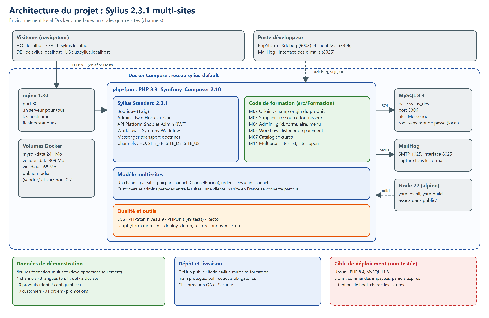
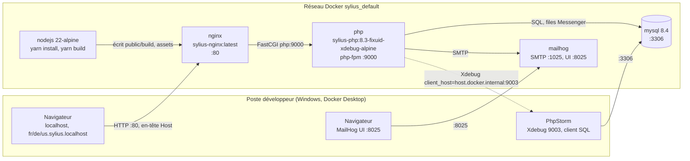
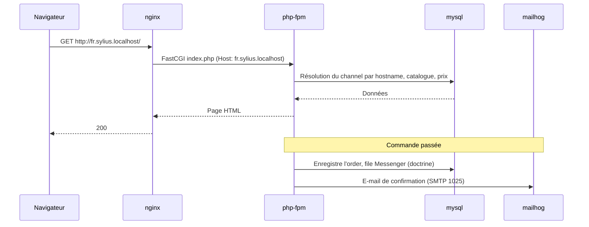

# Dossier d'architecture technique : images et conteneurs Docker

| | |
|---|---|
| Objet | Architecture de l'environnement Docker local de la plateforme Sylius multi-sites |
| Périmètre | Images, conteneurs, réseau, volumes, configuration, exploitation, sécurité et écarts avec le déploiement Upsun |
| Version de l'application | Sylius 2.3.1 (sylius-standard), PHP 8.3 |
| Faits vérifiés le | 2026-11-18, sur l'environnement local (commandes listées en section 13) |
| Statut | Document de travail, à relire par l'équipe |

> Ce document décrit l'environnement **de développement local**. Il n'existe aucun `Dockerfile` dans le projet : toutes les images sont des images publiées (Sylius, MySQL, Node, MailHog).

## 1. Vue d'ensemble

*Architecture du projet (source : [`diagrams/architecture-projet.svg`](diagrams/architecture-projet.svg)). Le schéma ci-dessous détaille les échanges entre les conteneurs.*

Cinq services : `php`, `nginx`, `mysql`, `mailhog` et `nodejs`. Le conteneur `nodejs` est un travail ponctuel : il installe les dépendances front et construit les assets, puis s'arrête.

## 2. Inventaire des images

| Service | Image (tag) | Système | Taille locale | Version du logiciel vérifiée | Rôle |
|---|---|---|---|---|---|
| php | `ghcr.io/sylius/sylius-php:8.3-fixuid-xdebug-alpine` | Alpine Linux | 293 Mo | PHP 8.3.33 (NTS), Composer 2.10.2 | PHP-FPM, console Symfony, Composer, Xdebug |
| nginx | `ghcr.io/sylius/sylius-nginx:latest` | Alpine Linux | 62,4 Mo | nginx 1.30.6 | Reverse proxy et fichiers statiques |
| mysql | `mysql:8.4` (plateforme `linux/amd64`) | (image officielle) | 810 Mo | MySQL 8.4.11 | Base de données et files Messenger |
| nodejs | `node:22-alpine` | Alpine Linux | 168 Mo | Node 22 (tag) | Build des assets (yarn) |
| mailhog | `mailhog/mailhog:latest` | (non vérifié) | 392 Mo | non récupérée | Capture des e-mails sortants |

Total des images : environ 1,7 Go. Le fichier `compose.yml` déclare l'image PHP `sylius-php:8.3-alpine` ; `compose.override.yml` la remplace par la variante `fixuid-xdebug` (le nom du tag indique l'alignement UID/GID sur `DOCKER_USER` et l'extension Xdebug).

## 3. Composants

### 3.1 php

| Élément | Valeur |
|---|---|
| Processus | `php-fpm` (maître et pool `www`), utilisateur non root `sylius` (UID:GID `DOCKER_USER`, 1000:1000 par défaut) |
| Port | 9000 (interne, non publié) |
| Démarre après | `mysql` en bon état (healthcheck) |
| Extensions notables | intl, gd, exif, sodium, pdo_mysql, apcu, OPcache, xdebug, zip, mbstring |
| Limites vérifiées | `memory_limit` 3G, `max_execution_time` 0 (CLI), `upload_max_filesize` 5M, `post_max_size` 6M, `realpath_cache_size` 4096K, fuseau UTC |
| Montages | code `.` (rw, cached), `public/` (rw, delegated), `public-media`, `vendor-data`, `var-data` |

C'est dans ce conteneur que s'exécutent toutes les commandes (`php bin/console …`, `vendor/bin/phpunit`, ECS, PHPStan). Ajouter `XDEBUG_MODE=off` accélère nettement les commandes lorsqu'on ne débogue pas.

### 3.2 nginx

Une seule configuration (`/etc/nginx/conf.d/default.conf`) : racine `/srv/sylius/public`, repli sur `index.php`, FastCGI vers `php:9000`, et **404 pour tout autre fichier `.php`**. Il n'y a pas de `server_name` : le même serveur répond à tous les noms d'hôte. C'est Sylius qui choisit le channel d'après l'en-tête `Host` (HQ sur `localhost`, puis `fr.`, `de.` et `us.sylius.localhost`).

### 3.3 mysql

MySQL 8.4, `utf8mb4`, `innodb_buffer_pool_size` 128 Mo (valeur par défaut). Compte `root` **sans mot de passe** (`MYSQL_ALLOW_EMPTY_PASSWORD=1`). Healthcheck : `SHOW databases;` toutes les secondes, 10 essais. Base du projet : `sylius_dev` (environ 5 Mo de données). Les files Messenger utilisent aussi cette base (transport `doctrine://default`).

### 3.4 mailhog

Reçoit tous les e-mails (`MAILER_DSN=smtp://mailhog:1025`), interface sur le port 8025. Marqué « do not use in production » dans le compose.

### 3.5 nodejs

Exécute `yarn install` puis `yarn build` au démarrage, avec le code monté en lecture et écriture. Il n'y a pas de serveur de développement front permanent : `make node-watch` lance `npm run watch` à la demande.

## 4. Réseau et ports

| Port hôte | Conteneur | Usage | Remarque |
|---|---|---|---|
| 80 | nginx | Les quatre sites | Publié sur toutes les interfaces |
| 3306 | mysql | Client SQL (PhpStorm) | Publié sur toutes les interfaces, compte root sans mot de passe |
| 8025 | mailhog | Interface web des e-mails | Publié sur toutes les interfaces |
| 9003 (sortant) | PhpStorm | Xdebug (conteneur vers hôte) | `host.docker.internal` |
| 9000, 1025 | php, mailhog | Interne uniquement | Non publiés |

Un seul réseau, `sylius_default`. Les services se joignent par leur nom (`php`, `mysql`, `mailhog`). Les noms `*.sylius.localhost` pointent sur 127.0.0.1 sans entrée dans le fichier `hosts`, car `.localhost` est résolu en local par le navigateur et le système.

## 5. Stockage

| Volume ou montage | Contenu | Taille mesurée | Persistance |
|---|---|---|---|
| `mysql-data` | Données MySQL | 241 Mo | Conservé jusqu'à `make clean` |
| `vendor-data` | `vendor/` (dépendances PHP) | 309 Mo | Idem |
| `var-data` | `var/` (cache, journaux) | 168 Mo | Idem |
| `public-media` | `public/media` (images produits) | < 1 Mo | Idem |
| Montage `.` → `/srv/sylius` | Code source du poste | n/a | Dossier du poste |
| Montage `public/` | Assets construits | n/a | Dossier du poste, en lecture seule côté nginx |

**Pourquoi `vendor/` et `var/` sont dans des volumes** : sous Windows, le montage du disque `C:\` dans Docker est de 10 à 50 fois plus lent que le système de fichiers interne. Le chauffage du cache Symfony prenait plus de 25 minutes avec le montage direct. Ce choix est local au fichier `compose.override.yml`, qui n'est pas versionné.

Conséquence : `vendor/` n'existe **pas** sur le disque du poste. Pour lire le code de Sylius, il faut passer par `docker compose exec php` ou par le dépôt GitHub de Sylius.

## 6. Configuration

Variables injectées dans le conteneur `php` (`compose.override.yml`) :

| Variable | Valeur locale | Rôle |
|---|---|---|
| `APP_ENV` | `dev` | Environnement Symfony |
| `APP_SECRET` | `EDITME` | Secret Symfony, valeur factice de développement |
| `DATABASE_URL` | `mysql://root@mysql/sylius_%kernel.environment%` | Connexion MySQL |
| `MAILER_DSN` | `smtp://mailhog:1025` | Envoi des e-mails |
| `MESSENGER_TRANSPORT_DSN` et `SYLIUS_MESSENGER_TRANSPORT_*` | `doctrine://default` (files principales et promotions de catalogue), `sync://` (payment request) | Transports Messenger |
| `PHP_DATE_TIMEZONE` | `UTC` | Fuseau |
| `XDEBUG_MODE`, `XDEBUG_CONFIG`, `PHP_IDE_CONFIG` | `debug`, client `host.docker.internal:9003`, serveur `sylius` | Débogage PhpStorm |

Aucun secret réel dans ces valeurs. Les clés JWT et la clé de chiffrement des paiements restent hors de Git (`config/jwt/`, `config/encryption/`).

## 7. Flux principaux

Messenger : aucun conteneur ne consomme les files. Les promotions de catalogue ne s'appliquent qu'après `php bin/console messenger:consume` lancé à la main. Les e-mails passent par SMTP synchrone vers MailHog.

## 8. Exploitation

| Besoin | Commande |
|---|---|
| Démarrer / arrêter | `make up` / `make down` |
| Shell PHP | `make php-shell` (ou `docker compose exec php sh`) |
| Tout réinitialiser | `make clean` : **supprime les volumes**, donc la base et les médias |
| Après recréation du conteneur php | `docker compose restart nginx` (sinon erreur 502 : nginx garde l'ancienne adresse de php) |
| Initialiser l'instance locale | `scripts/formation/init-local.sh` (réservé à `APP_ENV=dev`) |
| Instantané et restauration de la base | `scripts/formation/db-dump.sh`, `scripts/formation/db-restore.sh` |
| Contrôles qualité | `scripts/formation/qa.sh` dans le conteneur php |
| Commandes plus rapides sans débogage | préfixer par `XDEBUG_MODE=off` |

Sous Git Bash, préfixer par `MSYS_NO_PATHCONV=1` les commandes qui contiennent des chemins Linux, sinon Windows les convertit.

## 9. Sécurité de l'environnement local

| Point | Constat | Recommandation |
|---|---|---|
| MySQL exposé | Port 3306 publié sur toutes les interfaces, compte root sans mot de passe | Publier sur `127.0.0.1:3306:3306` (modifier `compose.override.yml`). À vérifier : le pare-feu Windows peut déjà bloquer les connexions entrantes |
| MailHog et nginx | Ports 80 et 8025 publiés sur toutes les interfaces | Idem, ou accepter pour un poste isolé |
| Tags `latest` | `sylius-nginx:latest` et `mailhog:latest` ne sont pas épinglés | Épingler une version (ou un condensat) pour reproduire un environnement |
| Utilisateur | Conteneur php en utilisateur non root | Conforme |
| Secrets | `APP_SECRET=EDITME`, aucune clé réelle | Conforme en local ; ne jamais réutiliser en production |
| Images | Pas d'analyse de vulnérabilités automatisée des images | Ajouter un scan (par exemple Trivy) si l'environnement sert de référence |
| Xdebug | Actif en permanence (`XDEBUG_MODE=debug`) | Passer à `off` hors débogage ; il ne doit jamais exister en production |

## 10. Écarts entre le local et le déploiement Upsun

La configuration `.upsun/config.yaml` fournie avec Sylius-Standard décrit un déploiement différent de l'environnement local. Elle n'a pas été testée pour ce projet. Le runbook de déploiement et les contrôles de CI sont résumés dans le [schéma CI/CD](diagrams/ci-cd.png).

| Sujet | Local (Docker) | Upsun (`.upsun/config.yaml`) |
|---|---|---|
| PHP | 8.3 | 8.4 |
| Base de données | MySQL 8.4 | `mysql:11.8` |
| Environnement | `dev`, débogage actif | `prod`, `APP_DEBUG=0` |
| Tâches planifiées | aucune | `sylius:cancel-unpaid-orders` et `sylius:remove-expired-carts`, à 02:00 |
| Consommation Messenger | à la main | aucun worker déclaré |
| Données au déploiement | `sylius:fixtures:load` à la main | **le hook de déploiement exécute `sylius:fixtures:load -n` à chaque déploiement** |
| Clés JWT | générées en local | `lexik:jwt:generate-keypair --skip-if-exists`, dossier monté en stockage |

Le dernier point contredit la règle du projet (« ne jamais lancer `sylius:fixtures:load` hors développement ») : le chargement vide la base. Il faut retirer cette ligne du hook de déploiement avant tout usage réel de cette configuration.

## 11. Risques et recommandations

| Priorité | Risque | Action |
|---|---|---|
| Haute | Le hook Upsun charge les fixtures à chaque déploiement | Supprimer `sylius:fixtures:load` du hook `deploy` |
| Haute | Promotions de catalogue sans effet faute de worker | Déclarer un worker `messenger:consume` en déploiement ; le lancer à la main en local |
| Moyenne | MySQL root sans mot de passe sur toutes les interfaces | Limiter à `127.0.0.1` |
| Moyenne | Écarts de versions (PHP 8.3 contre 8.4, MySQL 8.4 contre 11.8) | Aligner la version de PHP, et tester sur la base cible avant la production |
| Moyenne | Images non épinglées | Épingler les tags |
| Basse | Lenteur de Docker sous Windows | Garder `vendor/` et `var/` en volumes ; utiliser WSL2 si possible (non testé) |
| Basse | `nodejs` sans mode watch permanent | Lancer `make node-watch` quand on travaille sur le front |

## 12. Décisions d'architecture

| Décision | Choix | Raison |
|---|---|---|
| Images | Images officielles de Sylius, sans `Dockerfile` maison | Cohérence avec Sylius-Standard, aucune image à maintenir |
| `vendor/` et `var/` | Volumes Docker | Performance sous Windows (plus de 25 minutes de chauffage de cache avec le montage direct) |
| Transport Messenger | `doctrine://default` | Aucun service supplémentaire à exploiter (RabbitMQ ou Redis possibles plus tard) |
| E-mails | MailHog | Aucun envoi réel depuis un poste de développement |
| Multi-sites | Un seul serveur nginx, sélection du channel par hostname | Une seule pile pour les quatre sites |
| `compose.override.yml` | Local, non versionné | Réglages propres au poste (volumes, utilisateur) |

## 13. Vérifications et limites

Faits relevés par `docker compose ps`, `docker images`, `docker volume ls`, `php -v` et `php -m`, `php -i`, `mysql select version()`, `nginx -v` et la lecture de `compose.yml`, `compose.override.yml`, `.upsun/config.yaml`, `Makefile` et `default.conf`.

Non vérifié : la version de MailHog et son système de base ; le comportement du pare-feu Windows sur les ports publiés ; le déploiement Upsun ; les besoins mémoire de Docker Desktop.
