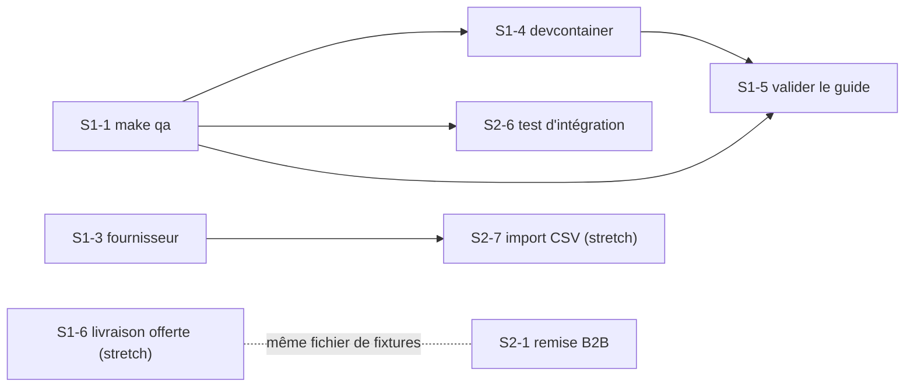

# Roadmap : deux sprints de deux semaines

Cette roadmap fait évoluer les sites e-commerce du projet avec de nouvelles fonctionnalités, et elle sert de terrain d'entraînement : chaque ticket peut être **simulé sur une machine de développement** avec le [process agentique](process-agentique.md), en suivant le guide [Simuler un ticket](simuler-un-ticket.md). Le guide sera validé sur une machine vierge par le ticket S1-5 ; les tickets protégés s'arrêtent au plan, et ceux qui visent une autre plateforme (devcontainer, CI) ne se simulent qu'en partie.

## Objectifs

1. **Fonctionnalités** : enrichir les quatre sites (origine et fournisseur des produits, promotions B2B et de livraison, export des commandes, alerte de stock).
2. **Reproductibilité** : n'importe quel développeur obtient un poste opérationnel et lance les mêmes contrôles (`make qa` disponible, devcontainer à venir : S1-4).
3. **Process agentique** : pratiquer la boucle explorer, plan validé, implémentation, contrôle, relecture, pull request sur des tickets réels.
4. **Industrialisation** : worker Messenger, build du front et tests d'intégration en CI.

## Suivi

| Élément | Où |
|---|---|
| Tickets | Issues du dépôt, un jalon par sprint (**Sprint 1**, **Sprint 2**) |
| Tableau | Projet GitHub « Roadmap Sylius multi-sites » du propriétaire (privé) : Status, Sprint, Estimation, Nature |
| Labels | `sprint-1`, `sprint-2`, `tech`, `process`, `agentique`, `stretch`, `fichiers-protégés`, `taille-S`, `taille-M`, `taille-L` |
| Modèles | `.github/ISSUE_TEMPLATE/` (ticket, bug) et `.github/PULL_REQUEST_TEMPLATE.md` : le formulaire de ticket n'applique ni label, ni jalon, ni projet, à renseigner à la main |

## Sprint 1 : socle reproductible et premières fonctionnalités

Du lundi 23 novembre au vendredi 4 décembre 2026. Charge estimée : **7,5 jours** sur 10 (+ 1 jour de stretch).

| Ticket | Titre | Taille | Charge (j) | Nature | Dépend de | Protégé |
|---|---|---|---|---|---|---|
| [#10](https://github.com/ifeddi/sylius-multisite-formation/issues/10) S1-1 | Cibles `make qa` et `make test` dans le conteneur | S | 0,5 | Technique | | oui |
| [#11](https://github.com/ifeddi/sylius-multisite-formation/issues/11) S1-2 | Afficher l'origine du produit sur la fiche boutique | M | 1 | Fonctionnalité | | oui |
| [#12](https://github.com/ifeddi/sylius-multisite-formation/issues/12) S1-3 | Lier un fournisseur à un produit (relation, colonne, filtre) | M | 2 | Fonctionnalité | | non |
| [#13](https://github.com/ifeddi/sylius-multisite-formation/issues/13) S1-4 | Environnement de développement reproductible (devcontainer) | L | 3 | Technique | S1-1 | oui |
| [#14](https://github.com/ifeddi/sylius-multisite-formation/issues/14) S1-5 | Valider le guide « Simuler un ticket » sur une machine vierge | M | 1 | Documentation | S1-1, S1-4 | non |
| [#15](https://github.com/ifeddi/sylius-multisite-formation/issues/15) S1-6 | Livraison offerte au-dessus d'un seuil, par channel (**stretch**) | M | 1 | Fonctionnalité | | non |

Ordre recommandé : S1-1, S1-2, S1-3, S1-4, S1-5 (en dernier, pour documenter le flux final), puis S1-6 s'il reste de la capacité.

## Sprint 2 : fonctionnalités e-commerce et industrialisation

Du lundi 7 au vendredi 18 décembre 2026. Charge estimée : **8 jours** sur 10 (+ 3 jours de stretch).

| Ticket | Titre | Taille | Charge (j) | Nature | Dépend de | Protégé |
|---|---|---|---|---|---|---|
| [#16](https://github.com/ifeddi/sylius-multisite-formation/issues/16) S2-1 | Remise B2B par palier de quantité (groupe wholesale) | M | 1 | Fonctionnalité | | non |
| [#17](https://github.com/ifeddi/sylius-multisite-formation/issues/17) S2-2 | Export CSV des commandes par channel | M | 1,5 | Fonctionnalité | | non |
| [#18](https://github.com/ifeddi/sylius-multisite-formation/issues/18) S2-3 | Worker Messenger comme service Docker Compose | M | 1 | Technique | | oui |
| [#19](https://github.com/ifeddi/sylius-multisite-formation/issues/19) S2-4 | Alerte de stock bas dans l'administration | M | 1,5 | Fonctionnalité | | non |
| [#20](https://github.com/ifeddi/sylius-multisite-formation/issues/20) S2-5 | Build des assets front en CI | M | 1 | Technique | | oui |
| [#21](https://github.com/ifeddi/sylius-multisite-formation/issues/21) S2-6 | Test d'intégration avec vraie base de données pour `formation:sites:open` | M | 2 | Technique | S1-1 | oui |
| [#22](https://github.com/ifeddi/sylius-multisite-formation/issues/22) S2-7 | Import de produits depuis un CSV, idempotent, avec `--dry-run` (**stretch**) | L | 3 | Fonctionnalité | S1-3 | non |

Ordre recommandé : S2-1, S2-2, S2-3, S2-4, S2-5, S2-6, puis S2-7 s'il reste de la capacité (à scinder en deux si le sprint est serré).

## Dépendances et conflits

## Prêt et terminé

**Un ticket est prêt** quand il a : un contexte, un objectif, des critères d'acceptation testables, des pistes vérifiées dans le code (ou marquées « non vérifié »), ses dépendances et une estimation.

**Un ticket est terminé** quand : les critères d'acceptation sont vérifiés, les contrôles sont verts (ECS, PHPStan niveau 9, PHPUnit), la documentation est à jour, et la pull request liée (`Closes #N`) a été relue par un second agent puis validée par un humain.

## Fichiers protégés

Les tickets marqués « protégé » touchent des fichiers désignés dans `.github/CODEOWNERS` (`.github/`, `scripts/`, `Makefile`, `compose*.yml`, `.claude/`, `CLAUDE.md`). Le prompt de l'agent `backend-dev` exclut ces fichiers de son périmètre, et les règles `ask` de `.claude/settings.json` demandent une confirmation pour plusieurs d'entre eux (`compose*.yml` n'est protégé que par CODEOWNERS). Chaque modification passe par une validation humaine, et la simulation peut s'arrêter au plan.

## Risques de la roadmap

- Les estimations viennent d'une exploration en lecture seule du code : elles sont à réviser après le premier ticket.
- Le Sprint 1 est chargé à environ 75 % et le Sprint 2 à 80 % : peu de marge pour les relectures et les imprévus.
- `composer.lock` et `yarn.lock` ne sont pas versionnés : le build du front et les caches de CI ne sont pas reproductibles (voir S2-5).
- Plusieurs éléments restent « non vérifiés » dans les tickets (comportement de Codespaces, règles de promotion par quantité, base de test) : chacun est signalé dans le ticket concerné.
- Les tickets S1-6 et S2-1 modifient le même fichier de fixtures : les traiter à la suite l'un de l'autre.

## Faire évoluer la roadmap

Un nouveau ticket utilise le modèle `ticket` (formulaire d'issue). Un changement de priorité ou de périmètre se fait dans le tableau et dans le ticket, puis dans ce document par pull request.
